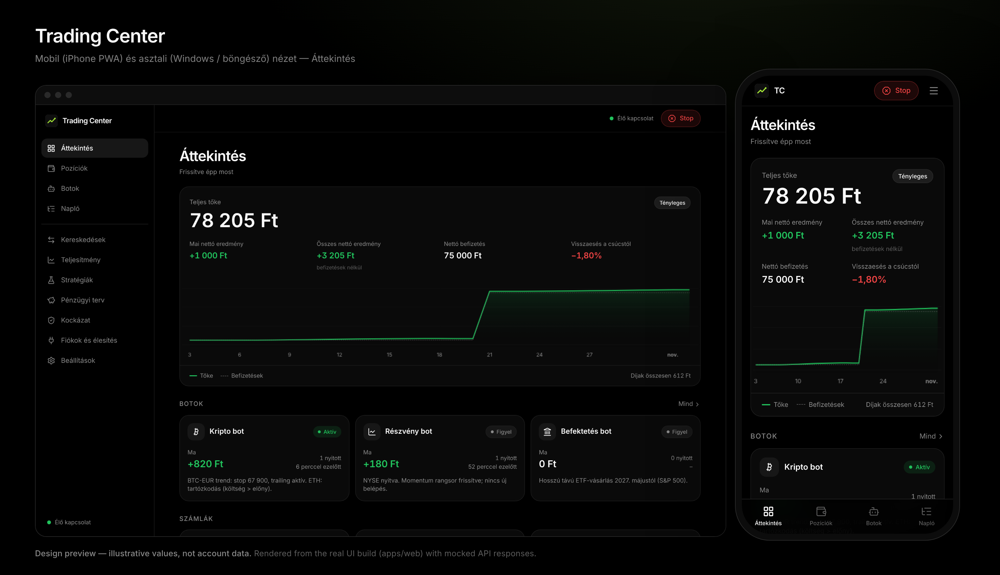

# Trading Center V2 (ikt)

Autonomous, single-user trading platform: Trading 212 (stocks/ETFs), Bitvavo (crypto), Revolut
signal-only. Rust (Tokio/Axum/SQLx) + MySQL, Next.js PWA for iPhone (Face ID passkeys, Web Push),
Tauri 2 Windows shell, Docker Compose on a VPS behind Caddy (HTTPS).

> Real money. The system abstains unless a strategy has passed out-of-sample validation and every
> deterministic risk check. No returns are promised. Withdrawals are never initiated by the bot.


*Design preview — illustrative values, not account data.*

## Start here
| | |
|---|---|
| Current state, verified features, blockers | [`docs/STATUS.md`](docs/STATUS.md) |
| Deploy to a VPS | [`docs/deployment.md`](docs/deployment.md) |
| Onboarding (passkey, broker keys, risk, authorization) | [`docs/setup.md`](docs/setup.md) |
| Architecture decisions | [`docs/decisions/`](docs/decisions/) |
| API contract | [`docs/api.md`](docs/api.md) |
| UI | [`docs/ui.md`](docs/ui.md) |
| Backtest evidence | [`docs/backtests/`](docs/backtests/) |
| Claude Code team setup | [`CLAUDE.md`](CLAUDE.md), [`.claude/`](.claude/) |

## Develop
```bash
make check          # fmt, clippy -D warnings, unit tests, web typecheck/lint/build
make db-test        # MySQL 8.4 integration tests in a throwaway container
cargo run -p tc-cli -- backtest --data data/candles/*.csv   # after `tc fetch-candles`
```
